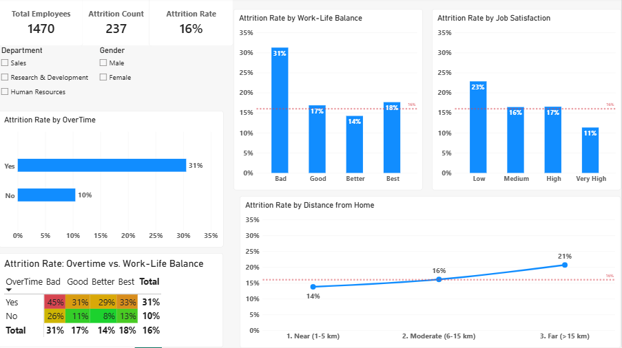

# 📊 People Analytics Dashboard: Attrition & Employee Well-being

## 📌 Visão Geral do Projeto
Este projeto consiste num **Dashboard Interativo em Power BI** desenvolvido para analisar os fatores determinantes do *turnover* (saída involuntária e voluntária de colaboradores / *attrition*) numa organização. 

O objetivo principal é identificar padrões de risco associados ao impacto do trabalho extraordinário (*OverTime*), equilíbrio entre vida pessoal e profissional (*Work-Life Balance*), satisfação no trabalho (*Job Satisfaction*) e distância ao local de trabalho (*Distance from Home*), fornecendo *insights* baseados em dados para a tomada de decisão nas equipas de People Operations / HR.

---

## 📈 Principais Indicadores (KPIs)
- **Total de Colaboradores:** 1.470
- **Total de Saídas (Attrition Count):** 237
- **Taxa de Attrition Global:** 16,12% (linha de referência média)

---

## 🧠 Principais Fatores e Insights Identificados

### 1. Trabalho Extraordinário (OverTime)
- **Impacto Direto:** Colaboradores que realizam horas extraordinárias apresentam uma taxa de *attrition* de **31%**, comparada com apenas **10%** nos colaboradores sem horas extra.

### 2. Equilíbrio Vida Pessoal / Profissional (Work-Life Balance)
- **Risco Crítico:** Colaboradores que classificam o seu equilíbrio como **"Bad"** registam uma taxa de *attrition* de **31%** (praticamente o dobro da média global da empresa de 16%).
- **Efeito Cruzado (OverTime vs. Work-Life Balance):** A matriz de análise revela que o cenário mais crítico ocorre quando há **OverTime = Yes** combinado com **Work-Life Balance = Bad**, onde a taxa de saída atinge **45%**.

### 3. Satisfação no Trabalho (Job Satisfaction)
- Colaboradores com **"Low"** satisfação no trabalho têm a maior taxa de rotatividade (**23%**).
- À medida que a satisfação aumenta para *Very High*, a taxa de *attrition* cai para **11%**.

### 4. Distância da Residência ao Trabalho (Distance from Home)
- Existe uma tendência clara de crescimento na taxa de saída consoante a distância:
  - **Próximo (1-5 km):** 14%
  - **Moderado (6-15 km):** 16%
  - **Longe (>15 km):** 21%

---

## 🛠️ Tecnologias & Ferramentas Utilizadas
- **Power BI Desktop:** Construção do relatório e visualizações interativas.
- **DAX (Data Analysis Expressions):** Criação de medidas calculadas (Taxas de Attrition, Contagens e Filtros de Contexto).
- **Power Query:** Limpeza, transformação e categorização de dados (ex: segmentação por intervalos de distância).
- **Modelagem de Dados:** Estruturação em *Star Schema* (Tabelas Fato e Dimensão).

---

## 🗂️ Filtros Interativos Disponíveis
O dashboard permite filtrar e segmentar dinamicamente a análise por:
- **Departamento:** *Sales*, *Research & Development*, *Human Resources*
- **Género:** *Male*, *Female*

---

## 🚀 Como Explorar este Projeto

1. **Download do Ficheiro:**
   - Descarrega o ficheiro `.pbix` disponível na lista de ficheiros deste repositório.
2. **Execução:**
   - Abre o ficheiro descarregado utilizando o **Power BI Desktop**.
   - Explora as interações entre os visuais utilizando os filtros laterais (Departamento e Género).
